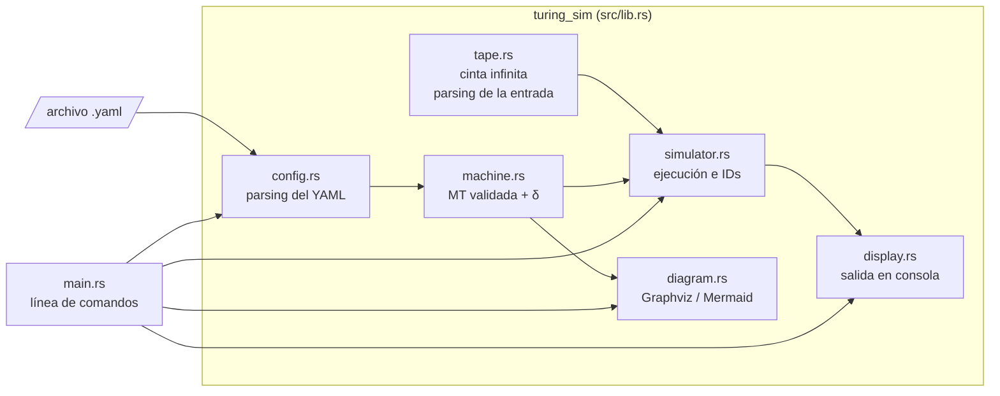

# Arquitectura del simulador

El programa está escrito en **Rust** y separado en módulos pequeños, cada uno con una
sola responsabilidad. La lógica vive en una biblioteca (`src/lib.rs`) y el ejecutable
(`src/main.rs`) solo la usa; así las pruebas pueden usar la MT sin pasar por la consola.



## Flujo de una ejecución

1. **`main.rs`** lee los argumentos (`archivo.yaml`, `--input`, `--max-steps`, …).
2. **`config.rs`** convierte el texto YAML en estructuras de Rust (`RawMachine`,
   `RawTransition`) usando `serde`. Aquí todavía no se revisa nada de la teoría.
3. **`machine.rs`** construye la `TuringMachine` y **valida la definición formal**.
   Reporta todos los problemas juntos, por ejemplo:
   - el estado inicial o los de aceptación no están en `states`,
   - Σ ⊄ Γ, o el blanco no está en Γ, o el blanco está en Σ,
   - una transición usa un estado o símbolo que no existe,
   - un movimiento distinto de `L`, `R` o `S`,
   - dos transiciones con el mismo lado izquierdo (la MT no sería determinista).
4. Para cada cadena, **`tape.rs`** la separa en símbolos del alfabeto de entrada
   (parsing de la entrada en la cinta) y **`simulator.rs`** ejecuta la MT y guarda
   una descripción instantánea (ID) por paso.
5. **`display.rs`** imprime la definición formal, las IDs, el veredicto y una tabla resumen.
6. Opcionalmente **`diagram.rs`** exporta el diagrama de estados.

## Estructuras de datos

### Control finito: `[estado, caché]`

Como en el laboratorio 10, el control finito es una tupla `[estado, caché]`. La caché
guarda un símbolo de la cinta, así la MT puede "recordar" un símbolo sin tener un estado
por cada letra del alfabeto. Una MT que no la necesita deja la caché en `B` siempre.

En el YAML (formato del enunciado):

```yaml
- state: q0
  read: [a, B]     # [símbolo leído en la cinta, caché actual]
  write: [a, B]    # [caché nueva, símbolo que se escribe]
  move: R
  next: q1
```

equivale a **δ([q0, B], a) = ([q1, a], B, R)**. Para máquinas sin caché también se
acepta el formato corto `read: a` / `write: X` (la caché queda en blanco).

### Función de transición

```rust
pub struct TransitionKey { state, cache, symbol }        // lado izquierdo de δ
pub struct Action { next, new_cache, write, movement }   // lado derecho de δ
index: HashMap<TransitionKey, usize>                     // δ en O(1)
```

Las transiciones se guardan en un `Vec` (en el orden del archivo, para numerarlas al
mostrarlas y dibujarlas) y en un `HashMap` que va de la llave `(estado, caché, símbolo)`
a la posición en ese `Vec`. Buscar la transición de cada paso cuesta O(1) sin importar
cuántas tenga la máquina, y el `HashMap` también sirve para detectar no determinismo al
cargar el archivo.

### Cinta

```rust
pub struct Tape { cells: VecDeque<Symbol>, head: usize, blank: Symbol }
```

La cinta es infinita en ambas direcciones, pero solo se guarda la parte visitada en un
`VecDeque`. Si la cabeza se mueve a la izquierda de la celda 0 se agrega un blanco al
frente (`push_front`), y si se pasa del final se agrega uno atrás (`push_back`). Las dos
operaciones son O(1), así que la cinta crece sin costo extra.

Los símbolos son `String` y no `char`, para permitir símbolos de varios caracteres. La
entrada se separa con la coincidencia más larga del alfabeto, o por espacios si la cadena
los tiene (`"a1 a2 b1"`).

### Descripción instantánea (ID)

```rust
pub struct InstantaneousDescription {
    step, state, cache,
    tape: TapeView { left, head, right },   // α | símbolo leído | resto de β
    applied: Option<usize>,                 // transición que produjo esta ID
}
```

Se muestra en la notación de clase **α[q, c]β**: α es la cinta a la izquierda de la
cabeza y β empieza con el símbolo que se está leyendo. Los blancos de los extremos se
recortan, salvo el que está bajo la cabeza. Por ejemplo, la ID `XY[q8, B]YZZ` significa:
la cinta es `XYYZZ`, la cabeza está sobre la segunda `Y`, el estado es `q8` y la caché `B`.

## Reglas de parada

| Situación | Resultado |
|---|---|
| La MT entra a un estado de `accept_states` | **ACEPTADA**: la última ID contiene un estado de aceptación |
| No existe δ para `[estado, caché]` y el símbolo leído | **RECHAZADA**: la MT se detiene fuera de F |
| Se alcanza `--max-steps` (por defecto 10 000) | **RECHAZADA**: posible ciclo infinito |
| La cadena tiene símbolos fuera de Σ | **RECHAZADA** antes de empezar |

## Pruebas

`cargo test` corre:

- **Pruebas unitarias** de cada módulo: parsing, validación, cinta, simulación (incluye
  las IDs exactas del laboratorio 9) y diagramas.
- **Pruebas exhaustivas** (`tests/maquinas.rs`): cada MT de `maquinas/` se compara con
  la respuesta calculada directamente en Rust para **todas** las cadenas hasta cierta
  longitud (por ejemplo, las 9 841 cadenas sobre {a, b, c} de longitud ≤ 8 para la MT
  reconocedora y las 5 461 cadenas sobre {a, b, c, d} de longitud ≤ 6 para la de
  ordenamiento).
