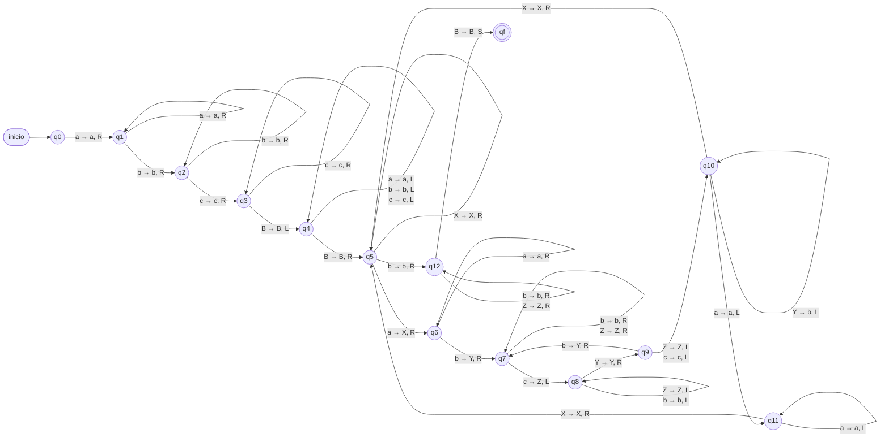
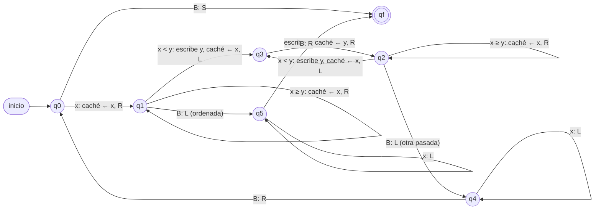
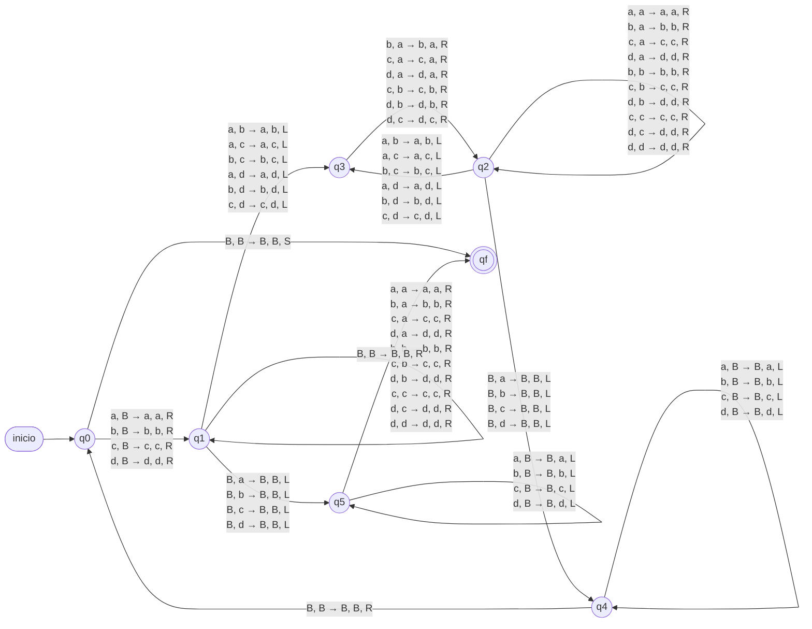

# Máquinas de Turing del proyecto

Las dos máquinas que pide el enunciado están en `maquinas/`. En `maquinas/extra/` hay
otras tres que muestran más funciones del simulador.

| Archivo | Tipo | Qué hace | Estados | δ |
|---|---|---|---|---|
| `maquinas/reconocedora_multiplicacion.yaml` | Reconocedora | a^i b^j c^k con k = i·j | 14 | 33 |
| `maquinas/alteradora_ordenamiento.yaml` | Alteradora | Ordena una cadena sobre {a,b,c,d} (burbuja) | 7 | 61 |
| `maquinas/extra/alteradora_unario_a_binario.yaml` | Alteradora | aⁿ → n en binario | 10 | 21 |
| `maquinas/extra/reconocedora_palindromos.yaml` | Reconocedora | Palíndromos sobre {a,b,c} usando la caché | 5 | 26 |
| `maquinas/extra/lab9_incremento_binario.yaml` | Alteradora | Ejemplo del laboratorio 9 | 3 | 6 |

---

## 1. MT reconocedora: L = { aⁱ bʲ cᵏ | i, j ≥ 1, k = i·j }

La máquina **verifica una multiplicación**: acepta si el número de c's es exactamente el
producto del número de a's por el número de b's.

**¿Por qué es interesante?** L **no es libre de contexto**: ningún autómata de pila la
reconoce, porque tendría que comparar k con un producto y no solo contar. La MT lo
resuelve con **dos ciclos anidados** sobre la cinta, igual que un `for` dentro de otro:

```text
para cada a (marcarla X):
    para cada b (marcarla Y):
        tachar una c (marcarla Z)       ← si no quedan c's: RECHAZAR (k < i·j)
    restaurar las Y a b
al final: si queda alguna c sin tachar: RECHAZAR (k > i·j), si no: ACEPTAR
```

### Definición formal

- Q = {q0, q1, …, q12, qf}
- Σ = {a, b, c}
- Γ = {a, b, c, X, Y, Z, B}
- q0 = estado inicial, B = blanco, F = {qf}
- Esta máquina no usa la caché (siempre es B).

| Fase | Estados | Función |
|---|---|---|
| 1 | q0 – q3 | Valida que la entrada tenga la forma a⁺ b⁺ c⁺ |
| 1 | q4 | Regresa la cabeza al inicio |
| 2 | q5 – q6 | Ciclo externo: marca la siguiente `a` con `X` y la primera `b` con `Y` |
| 3 | q7 – q9 | Ciclo interno: por cada `b` tacha una `c` con `Z` |
| 4 | q10 – q11 | Restaura las `Y` a `b` y regresa a la siguiente `a` |
| 5 | q12 | Ya no hay `a`: revisa que no sobren `c` y acepta |

Complejidad: **O(n²)** pasos.

### Diagrama de estados

Etiquetas: `leído → escrito, movimiento`.



<details>
<summary>Funciones de transición (33)</summary>

```text
1. δ([q0, B], a) = ([q1, B], a, R)
2. δ([q1, B], a) = ([q1, B], a, R)
3. δ([q1, B], b) = ([q2, B], b, R)
4. δ([q2, B], b) = ([q2, B], b, R)
5. δ([q2, B], c) = ([q3, B], c, R)
6. δ([q3, B], c) = ([q3, B], c, R)
7. δ([q3, B], B) = ([q4, B], B, L)
8. δ([q4, B], a) = ([q4, B], a, L)
9. δ([q4, B], b) = ([q4, B], b, L)
10. δ([q4, B], c) = ([q4, B], c, L)
11. δ([q4, B], B) = ([q5, B], B, R)
12. δ([q5, B], X) = ([q5, B], X, R)
13. δ([q5, B], a) = ([q6, B], X, R)
14. δ([q5, B], b) = ([q12, B], b, R)
15. δ([q6, B], a) = ([q6, B], a, R)
16. δ([q6, B], b) = ([q7, B], Y, R)
17. δ([q7, B], b) = ([q7, B], b, R)
18. δ([q7, B], Z) = ([q7, B], Z, R)
19. δ([q7, B], c) = ([q8, B], Z, L)
20. δ([q8, B], Z) = ([q8, B], Z, L)
21. δ([q8, B], b) = ([q8, B], b, L)
22. δ([q8, B], Y) = ([q9, B], Y, R)
23. δ([q9, B], b) = ([q7, B], Y, R)
24. δ([q9, B], Z) = ([q10, B], Z, L)
25. δ([q9, B], c) = ([q10, B], c, L)
26. δ([q10, B], Y) = ([q10, B], b, L)
27. δ([q10, B], X) = ([q5, B], X, R)
28. δ([q10, B], a) = ([q11, B], a, L)
29. δ([q11, B], a) = ([q11, B], a, L)
30. δ([q11, B], X) = ([q5, B], X, R)
31. δ([q12, B], b) = ([q12, B], b, R)
32. δ([q12, B], Z) = ([q12, B], Z, R)
33. δ([q12, B], B) = ([qf, B], B, S)
```

</details>

### Cadenas para el video (longitud ≥ 5)

| Cadena | Long. | i·j | k | Resultado | Pasos |
|---|---|---|---|---|---|
| `abbcc` | 5 | 1·2 = 2 | 2 | ✅ ACEPTADA | 32 |
| `aabbcccc` | 8 | 2·2 = 4 | 4 | ✅ ACEPTADA | 65 |
| `aaabbcccccc` | 11 | 3·2 = 6 | 6 | ✅ ACEPTADA | 108 |
| `aabbccc` | 7 | 2·2 = 4 | 3 | ❌ RECHAZADA (faltan c's) | 47 |
| `abbccc` | 6 | 1·2 = 2 | 3 | ❌ RECHAZADA (sobra una c) | 33 |
| `aabcbcc` | 7 | — | — | ❌ RECHAZADA (no es a⁺b⁺c⁺) | 4 |

---

## 2. MT alteradora: ordenamiento burbuja sobre {a, b, c, d}

La máquina **ordena alfabéticamente** la cadena de la cinta con el algoritmo de la
**burbuja** (bubble sort). Ejemplo: `dcbaa → aabcd`, `cabdacbd → aabbccdd`.

**¿Por qué es interesante?** Implementa un algoritmo de ordenamiento real sobre la cinta,
con varias pasadas de ida y vuelta, y usa la **caché del control finito** (`[estado, caché]`,
como en el laboratorio 10) para recordar el símbolo anterior y compararlo con el actual.
Sin la caché haría falta un estado distinto por cada símbolo en cada fase.

### Definición formal

- Q = {q0, q1, q2, q3, q4, q5, qf}
- Σ = {a, b, c, d}
- Γ = {a, b, c, d, B}
- q0 = estado inicial, B = blanco, F = {qf}
- Control finito: [estado, caché], con caché ∈ {a, b, c, d, B}

| Estado | Función |
|---|---|
| q0 | Inicio de una pasada: guarda el primer símbolo en la caché |
| q1 | Recorre comparando cada símbolo `x` con el anterior `y` (caché). Todavía no hubo intercambios en esta pasada |
| q2 | Igual que q1, pero ya hubo al menos un intercambio en esta pasada |
| q3 | Completa un intercambio: escribe el menor en la celda de la izquierda |
| q4 | Fin de una pasada con intercambios: regresa al inicio y repite |
| q5 | Fin de una pasada sin intercambios: la cadena está ordenada, regresa al inicio y acepta |

Para `x < y` (par desordenado) el intercambio se hace en dos pasos:

```text
δ([q1, y], x) = ([q3, x], y, L)     escribe y donde estaba x, guarda x, retrocede
δ([q3, x], y) = ([q2, y], x, R)     escribe x donde estaba y, recupera y, avanza
```

Complejidad: **O(n²)** pasos.

### Diagrama simplificado

`x` es el símbolo leído, `y` el que está en la caché (el símbolo anterior).



<details>
<summary>Diagrama completo generado por el simulador</summary>

Etiquetas: `leído, caché → caché nueva, escrito, movimiento`.



</details>

<details>
<summary>Funciones de transición (61)</summary>

```text
1. δ([q0, B], a) = ([q1, a], a, R)
2. δ([q0, B], b) = ([q1, b], b, R)
3. δ([q0, B], c) = ([q1, c], c, R)
4. δ([q0, B], d) = ([q1, d], d, R)
5. δ([q0, B], B) = ([qf, B], B, S)
6. δ([q1, a], a) = ([q1, a], a, R)
7. δ([q1, a], b) = ([q1, b], b, R)
8. δ([q1, a], c) = ([q1, c], c, R)
9. δ([q1, a], d) = ([q1, d], d, R)
10. δ([q1, b], a) = ([q3, a], b, L)
11. δ([q1, b], b) = ([q1, b], b, R)
12. δ([q1, b], c) = ([q1, c], c, R)
13. δ([q1, b], d) = ([q1, d], d, R)
14. δ([q1, c], a) = ([q3, a], c, L)
15. δ([q1, c], b) = ([q3, b], c, L)
16. δ([q1, c], c) = ([q1, c], c, R)
17. δ([q1, c], d) = ([q1, d], d, R)
18. δ([q1, d], a) = ([q3, a], d, L)
19. δ([q1, d], b) = ([q3, b], d, L)
20. δ([q1, d], c) = ([q3, c], d, L)
21. δ([q1, d], d) = ([q1, d], d, R)
22. δ([q1, a], B) = ([q5, B], B, L)
23. δ([q1, b], B) = ([q5, B], B, L)
24. δ([q1, c], B) = ([q5, B], B, L)
25. δ([q1, d], B) = ([q5, B], B, L)
26. δ([q2, a], a) = ([q2, a], a, R)
27. δ([q2, a], b) = ([q2, b], b, R)
28. δ([q2, a], c) = ([q2, c], c, R)
29. δ([q2, a], d) = ([q2, d], d, R)
30. δ([q2, b], a) = ([q3, a], b, L)
31. δ([q2, b], b) = ([q2, b], b, R)
32. δ([q2, b], c) = ([q2, c], c, R)
33. δ([q2, b], d) = ([q2, d], d, R)
34. δ([q2, c], a) = ([q3, a], c, L)
35. δ([q2, c], b) = ([q3, b], c, L)
36. δ([q2, c], c) = ([q2, c], c, R)
37. δ([q2, c], d) = ([q2, d], d, R)
38. δ([q2, d], a) = ([q3, a], d, L)
39. δ([q2, d], b) = ([q3, b], d, L)
40. δ([q2, d], c) = ([q3, c], d, L)
41. δ([q2, d], d) = ([q2, d], d, R)
42. δ([q2, a], B) = ([q4, B], B, L)
43. δ([q2, b], B) = ([q4, B], B, L)
44. δ([q2, c], B) = ([q4, B], B, L)
45. δ([q2, d], B) = ([q4, B], B, L)
46. δ([q3, a], b) = ([q2, b], a, R)
47. δ([q3, a], c) = ([q2, c], a, R)
48. δ([q3, a], d) = ([q2, d], a, R)
49. δ([q3, b], c) = ([q2, c], b, R)
50. δ([q3, b], d) = ([q2, d], b, R)
51. δ([q3, c], d) = ([q2, d], c, R)
52. δ([q4, B], a) = ([q4, B], a, L)
53. δ([q4, B], b) = ([q4, B], b, L)
54. δ([q4, B], c) = ([q4, B], c, L)
55. δ([q4, B], d) = ([q4, B], d, L)
56. δ([q4, B], B) = ([q0, B], B, R)
57. δ([q5, B], a) = ([q5, B], a, L)
58. δ([q5, B], b) = ([q5, B], b, L)
59. δ([q5, B], c) = ([q5, B], c, L)
60. δ([q5, B], d) = ([q5, B], d, L)
61. δ([q5, B], B) = ([qf, B], B, R)
```

</details>

### Cadenas para el video (longitud ≥ 5)

| Entrada | Cinta final | Pasos |
|---|---|---|
| `dcbaa` | `aabcd` | 66 |
| `badcab` | `aabbcd` | 70 |
| `ddccbbaa` | `aabbccdd` | 174 |
| `cabdacbd` | `aabbccdd` | 90 |
| `abcdd` (ya ordenada) | `abcdd` | 12 |

---

## Máquinas extra

- **Unario a binario** (`extra/alteradora_unario_a_binario.yaml`): mantiene un contador
  binario a la izquierda de la entrada y le suma 1 (con acarreo) por cada `a` que tacha.
  `aaaaa → 101`, `aaaaaaaaaaaaa → 1101`.
- **Palíndromos** (`extra/reconocedora_palindromos.yaml`): borra el primer símbolo, lo
  lleva en la caché hasta el final y lo compara con el último.
- **Laboratorio 9** (`extra/lab9_incremento_binario.yaml`): reproduce las IDs del
  problema 2 del laboratorio 9 (entradas `100`, `10011`, `11`).
